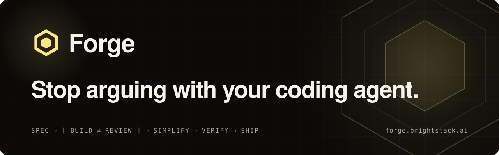

<h1 align="center"></h1>

Forge gets you from a rough idea to a spec worth building, and from a spec worth
building to working software somebody other than its author has reviewed. It runs
inside the agent you already use: Claude Code, Codex, Cursor, or Muse Code.

[](LICENSE)
[](https://forge.brightstack.ai/docs)

```text
→ a team on the job, not one agent working harder
→ the spec changes on purpose, or not at all
→ review with evidence, not vibes
→ proof in a real browser, not a green test run
→ your repository's standards, not ours
```

[Website](https://forge.brightstack.ai) · [Docs](https://forge.brightstack.ai/docs) · [Install](install.md) · From [Bright](https://www.brightstack.ai)

## See it in action

<p align="center"></p>

<details>
<summary>Transcript as text</summary>

```text
You:    Forge build a CSV export button on the reports page. Stop after Verify.

Forge:  CSV export for the reports page, stopping after Verify.
        Flow   Issue → Build ⇄ Review → Simplify → Verify
        Team   PM drafts the issue · Engineer builds · a separate Reviewer judges · QA verifies
        Go?

You:    Go.

Forge:  Issue drafted with 3 acceptance criteria. Approve?

You:    Approved.

Forge:  Build     ✓ implemented, tests added
        Review    ✗ P1: export ignores the active date filter (src/reports/export.ts:41)
        Repair    ✓ filter passed through, regression test added
        Review    ✓ PASS
        Simplify  ✓ nothing to simplify, prior Review stands
        Verify    ✓ clicked Export at 1440px and 390px, file matches the filtered table
        Stopped before Ship. Nothing pushed.
```

</details>

Every step leaves plain Markdown in `.forge/loops/<loop>/`: what was asked, what
you approved, what Review found, and the evidence Verify collected.

## Quick start

From the project you want Forge in. macOS and Linux, x64 and arm64.

```bash
# Cursor, Codex, Muse Code (installs into .agents)
curl -fsSL https://get.brightstack.ai/forge/install.sh | sh

# Claude Code (installs into .claude)
curl -fsSL https://get.brightstack.ai/forge/install.sh | FORGE_TOOLS=claude sh
```

That writes the `forge` CLI to `~/.local/bin` and runs `forge setup`, which pulls
the skills for that CLI's release tag into the project.

Or let your agent do it. Paste this into Claude Code, Codex, Cursor, or Muse Code:

```text
Read https://forge.brightstack.ai/install.md and follow it.
```

Restart your agent, then ask it for something:

```text
Forge explore what this repository is and what state it's in.
```

Exploring is read-only, so it's the cheapest way to see how Forge thinks. When
you're ready, ask for the work and say where to stop:

| Ask | You get |
| --- | --- |
| `Forge explore …` | Evidence, options, and open questions; no edits |
| `Forge spec …` | Product, design, technical, issue, bug, or work intent for you to approve |
| `Forge plan …` | An implementation approach |
| `Forge build …` | Implementation, independent review, and repair |
| `Forge review …` | A read-only engineering verdict |
| `Forge simplify …` | A simpler result, re-proved and re-reviewed |
| `Forge verify …` | The real behavior exercised, in a browser when it's UI |
| `Forge ship …` | Publication you authorized |
| `Forge explain …` | A read-only explanation of an artifact or change |
| `Forge finish …` | Approved spec and knowledge changes folded back at completion |

On Claude Code, setup also registers `/forge:spec`, `/forge:plan`, `/forge:build`,
`/forge:review`, `/forge:simplify`, `/forge:verify`, and `/forge:ship`.

## How it works

<p align="center"></p>

**You decide, the team builds.** An Engineer owns the change and can split it
across Workers, each with its own files to write. A separate Reviewer with a clean context
judges the integrated result. QA exercises the outcome. Every role is a
professional persona with its own instructions, not one agent playing all of
them in one long conversation.

**Guided by default.** Forge waits for your go before it dispatches work, and
again at a new spec or a consequential plan. Asking for full delivery doesn't
pre-approve work you haven't seen. Say `Auto` to grant more, and Forge stays
inside that grant.

**Quick or Full.** A small fix gets brief plan notes and proportionate proof. A
project gets product, design, and technical specs, and judges for every
dimension it earns.

**Use the whole line or one station.** Call any phase on its own and it stops at
its boundary. Building never authorizes publishing.

**Records you can read.** Each loop is a folder:

```text
.forge/loops/export-button/
├── index.md        # what we're delivering, who approved what, what's next
├── decisions.md    # the calls you made, protected from generic edits
├── log.md          # what happened, in order
├── spec/           # only the documents this work needs
├── build/log.md    # reviews, findings, repairs
└── verify/         # acceptance evidence, screenshots included
```

## Why Forge

- **Your decision is law.** Every call you make is written down where the next
  agent has to read it, so the pattern you chose in week one is still the pattern
  in week nine.
- **Change the spec on purpose.** You settle what done means once. Later changes
  arrive as deltas you accept or reject, and when a new requirement contradicts an
  accepted one, Forge brings you both with the evidence instead of quietly picking
  a winner.
- **Review past what your agent calls a code review.** Correctness, simplicity,
  spec compliance, design fidelity, accessibility, your repository's standards,
  and craft, each against its own rubric and evidence.
- **Evidence or it didn't happen.** A finding needs authority, a reachable
  trigger, observed evidence, and a real consequence. No quota, so a clean report
  means something.
- **Anti-slop.** After a few repairs, the team stops patching and rethinks the
  approach instead of leaving you a mountain of patches.
- **Tested like real users do.** Review asks whether the code is right; Verify
  asks whether the outcome happened, in a real browser at real viewports.
- **Your stack, your rules.** Forge reads your `AGENTS.md`, manifests, and code
  for languages, frameworks, commands, and conventions. When the evidence isn't
  there, it names the gap instead of inventing a house style.

## Works with

| Host | Installs into | Invoke |
| --- | --- | --- |
| Claude Code | `.claude/` | `/forge:build …` or `Forge build …` |
| Codex | `.agents/` | `Forge build …` |
| Cursor | `.agents/` (or `.cursor/` with `--tools cursor`) | `Forge build …` |
| Muse Code | `.agents/` | `Forge build …` |

Setup writes only Forge's own skills, its shared references, templates, and
personas into the project's `.forge/`, and on Claude Code the `commands/forge/`
phase commands, so your existing skills and custom agents stay as they are. Install into several
hosts at once with `forge setup --tools agents,claude`. See
[install.md](install.md) for hosts, PATH, and installing from a checkout.

## Configure

Everything is optional. A `forge.yml` at the application root can point Forge at
a curated harness instead of your root `AGENTS.md`, move loop records, and set
model and effort defaults per role:

```yaml
harness:
  path: docs/factory        # start here instead of the root AGENTS.md
storage:
  path: .forge
  loops: {path: loops}
engines:
  claude:
    models:
      reviewer: {effort: high}
```

Agents don't parse this file. Every Forge phase runs `forge context` first and
follows what it prints. Run it yourself to see what your agents will follow:

```bash
forge context --engine claude
```

Keep coding standards, testing conventions, and code examples in
`docs/standards/` (or `standards/` inside a curated harness). Forge doesn't
manage them; `forge context` lists every file there, from the repository root
down to the app, and agents open the ones that fit the work.

See the [configuration reference](references/cli.md#configuration-and-storage).

## The CLI

The lowercase `forge` executable does the bookkeeping: it installs skills,
initializes loops, creates and validates documents, records your decisions,
fingerprints the candidate, and applies approved spec changes. It never picks a
phase or judges a result, so there's no `forge build` shell command; that's the
skill's job.

```bash
forge init export-button --title "CSV export"
forge docs validate --loop export-button
forge candidate
```

See the [CLI guide](references/cli.md).

## Update

Give your agent the same line, or run the installer again, in each project that
has Forge (the CLI is shared, the skills are per project):

```bash
curl -fsSL https://get.brightstack.ai/forge/install.sh | sh                      # .agents
curl -fsSL https://get.brightstack.ai/forge/install.sh | FORGE_TOOLS=claude sh   # .claude
```

Updating replaces the CLI, Forge's own skills, and its shared `.forge/` material.
Your other skills, your custom agents, and your loop records stay as they are.
Restart your agent afterwards. Updating from an older version that left
`.forge/identities.json` behind? See [install.md](install.md#updating-from-older-versions).

## Develop

```bash
bun install --frozen-lockfile
bun run check
bun run build:cli
FORGE_TEST_BINARY="$PWD/dist/forge" bun test ./tests
```

These tests cover the CLI mechanics. The behavioral evals that measure
instruction quality live outside this repository.

## License

[MIT](LICENSE). Copyright 2026 Bright. Dependencies and attributed source retain
their own licenses. See [third-party notices](THIRD_PARTY_NOTICES.md).
